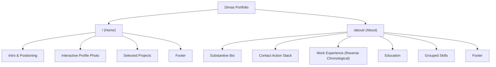
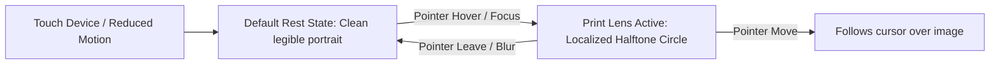
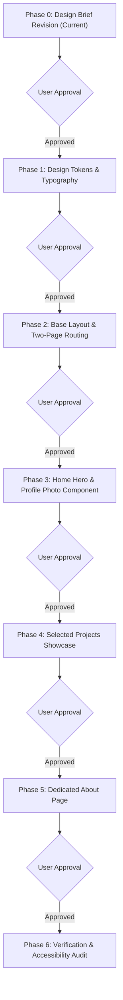

# Phase 0: Portfolio Redesign Research and Design Discovery Brief

This document establishes the evidence-based design and structural brief for redesigning Dimas's developer portfolio. It incorporates confirmed career positioning, a two-page sitemap, verified work experience and thesis benchmarks, an audited project inventory, a typography shortlist, profile photograph specifications, and the restrained hybrid interaction direction.

---

## Section 1: Portfolio direction and visual identity

### Professional positioning
The portfolio represents Dimas, a recent Informatics graduate targeting Data Engineering roles. The presentation emphasizes data processing pipelines, backend automation, database integrity, reproducible experimentation, and research analytics.

### Visual tone
The aesthetic direction is warm editorial, minimal, personal, and technically credible. It communicates craftsmanship and rigorous engineering without adopting the appearance of a generic template or an experimental art project that obstructs readability.

### Color system and accessibility requirements
The chosen palette uses four core tokens:

- Warm Paper (`#F7F5F0`): Primary canvas background.
- Charcoal (`#242321`): Primary text and high-contrast boundaries.
- Terracotta (`#DE7356`): Brand accent for primary action buttons, active navigation states, and graphic highlights.
- Sand (`#E8E1D7`): Secondary surface for cards, code tags, and subtle structural dividers.

Contrast and accessibility constraints:
- Terracotta on Warm Paper produces a contrast ratio of approximately 3.2:1. This fails the WCAG AA requirement of 4.5:1 for body copy and text under 18px (or 14px bold). Therefore, Terracotta must never be used for small body text.
- Terracotta is reserved for solid button fills (with light text), borders, UI badges, and large bold elements.
- Charcoal on Warm Paper delivers a 14.2:1 contrast ratio, comfortably exceeding the WCAG AAA threshold of 7:1 for all text sizes.
- Interactive states and keyboard focus indicators must maintain a distinct 2px solid boundary using Terracotta or Charcoal with a 2px offset.

### Brand identity
The portfolio identity is strictly "Dimas". Custom composite wordmarks such as "dimas // data" or "dimas // sys" are not approved and must not be used.

### Reference analysis: wisl.dev
Reference URLs:
- Home: https://wisl.dev/
- About: https://wisl.dev/about/

What to study on the reference site:
- Compact visual hierarchy: Generous whitespace balanced by high information density.
- Two-column asymmetrical hero: Direct copy on the left balanced by a strong visual element on the right.
- Restrained metadata presentation: Inline code chips indicating technologies without cluttering paragraphs.
- About page contact stack: A cohesive vertical stack of primary and secondary contact pill buttons.

What not to copy:
- The fox mascot branding and identity.
- The continuous canvas particle swarm, which consumes GPU cycles and can distract from reading.
- Default dark-mode styling, as this portfolio uses the warm paper palette.
- Copy or layout details that do not fit a Data Engineering graduate.

---

## Section 2: Sitemap and content structure

The website consists of exactly two pages. Main navigation items for Blog, Writing, Logs, or extra sub-pages are omitted.

### Home page (`/`)
1. Header: Site identity ("Dimas") and navigation link to About (`/about/`), plus external links to GitHub and CV.
2. Hero section:
   - Left column: Concise introduction and professional positioning as a Data Engineer focused on reproducible data pipelines, automated batch processing, and schema validation.
   - Right column: Large profile photograph with the restrained Print Lens interaction.
3. Selected projects section: Positioned immediately below the hero. Displays four curated engineering projects with clear links to source repositories or documented case studies.
4. Telemetry footer: Location (Bandung, Indonesia / WIB), live clock, email contact, and current engineering focus.

### About page (`/about/`)
1. Header: Identical global navigation with active state on About.
2. Narrative introduction: Substantive but concise biography discussing academic training in Informatics, focus on data pipelines, and software design philosophy.
3. Contact action stack: Vertical pill buttons for LinkedIn, GitHub, click-to-copy email, and CV download.
4. Work experience: Four confirmed professional roles listed in reverse chronological order with exact dates, locations, and descriptions.
5. Education: Degree details, institution, thesis topic, and confirmed thesis benchmarks.
6. Grouped technical skills: Structured categories (Data Engineering, Backend & Database, Applied AI & Analytics, Development Tools) supported by project evidence.
7. Telemetry footer: Identical global footer.

Language constraint: All portfolio copy must be written in natural professional English, preserving official Indonesian proper names and institutional titles.

---

## Section 3: Confirmed work experience

The following four positions represent the complete confirmed work history. Descriptions reflect verified responsibilities without exaggeration. The date overlap between the Multimedia Laboratory Assistant role and the BRIN internship is genuine and preserved as provided.

### 1. Laboratory Assistant - Multimedia
- Organization: Institut Teknologi Nasional (ITENAS)
- Dates: October 2025 - January 2026
- Arrangement: Part-time; on-site, Bandung
- Scope: Guided students during multimedia laboratory practical sessions and exercises.

### 2. Research & Development / IT Intern
- Organization: BRIN RI (Pusat Riset Sains Data dan Informasi)
- Dates: March 2025 - July 2025
- Arrangement: Internship; hybrid, Bandung
- Scope: Worked on Python-based data processing and topic modeling using BERTopic for the Collab Identifier research-collaboration analysis prototype.

### 3. Laboratory Assistant - Computer Networks
- Organization: Institut Teknologi Nasional (ITENAS)
- Dates: March 2025 - June 2025
- Arrangement: Part-time; on-site, Bandung
- Scope: Guided students during computer networks laboratory practical sessions and assignments.

### 4. Web Developer Intern
- Organization: Enclave
- Dates: September 2024 - February 2025
- Arrangement: Internship; hybrid, Bandung
- Scope: Developed web applications using Laravel and SQLite.

---

## Section 4: Confirmed thesis project facts

### Thesis title
- Official Indonesian title: "Evaluasi Komparatif Metode Topic Modeling untuk Rekomendasi Peneliti ke Kelompok Riset"
- English translation: "A Comparative Evaluation of Topic Modeling Methods for Researcher-to-Research-Group Recommendation"

### Confirmed corpus and experimental scope
- Dataset size: 11,111 prepared publication documents from 3,257 researchers across 12 CSRankings research areas.
- Evaluation split: 652 held-out test researchers evaluated on Precision@K, Recall@K, F1@K, NDCG@K, and Mean Reciprocal Rank (MRR).
- Models compared: Latent Dirichlet Allocation (LDA), Non-negative Matrix Factorization (NMF), and BERTopic with SPECTER domain embeddings.

### Verified benchmark result
- Reported best configuration: NMF + Cosine Similarity.
- Primary benchmark metric: Test NDCG@5 of 0.8127.

Discrepancy notice: Earlier project planning files in the repository noted preliminary counts of 8,729 publications and 86 held-out researchers. The user has confirmed that 11,111 publications and 652 held-out researchers are the official, finalized figures. These confirmed figures match the public repository documentation and are the definitive numbers for the portfolio.

---

## Section 5: Project selection and verification

All projects must be grounded in verified repository artifacts. Unsupported claims or missing materials are explicitly marked as "Needs confirmation".

| Project Name | Primary Domain | Public Repository URL | Verification Status | Role in Portfolio |
|---|---|---|---|---|
| MECUT Radar | Data Engineering | https://github.com/DimasBaskara666/mecut-radar | Verified repository; 183 tests and 92% coverage reported in README | Featured Lead Project |
| Researcher Recommendation | Applied ML / Data | https://github.com/DimasBaskara666/researchers_placement | Verified repository; matches confirmed thesis figures | Featured Academic Project |
| Collab Identifier Prototype | Graph Analytics | Private repository | Private code; requires screenshots and architecture diagram | Secondary Case Study |
| SMAN 2 Cimalaka Attendance | Software Engineering | https://github.com/DimasBaskara666/presensi-sman2-cimalaka | Verified repository; Next.js + Supabase SQL migrations | Secondary Project |
| Outbreak Data Pipeline | Data Engineering | None (Planned) | Architectural specification only; not implemented | Planned Architecture |

### 1. MECUT Radar (Featured Lead Project)
- Repository: https://github.com/DimasBaskara666/mecut-radar
- Description: Technology news ingestion and alert pipeline for the MECUT content workflow. Ingests articles from RSS feeds, Hacker News REST API, and GitHub Search API; normalizes schemas; deduplicates records; applies deterministic keyword scoring; stores state in SQLite; and dispatches alerts to Telegram.
- Verified engineering details:
  - Python 3.11+ application with strict YAML configuration (`config/sources.yaml`, `config/keywords.yaml`).
  - Zero cloud infrastructure cost (Rp0). Executes on scheduled GitHub Actions runners (`23 */3 * * *`).
  - Stateful database persistence across ephemeral runners using a dedicated orphan Git branch (`db-state`) committed via root trees.
  - SQLite WAL mode checkpointing and `PRAGMA integrity_check` validation.
  - Test suite status: README reports 183 passed tests and 92% statement coverage using pytest fixtures and mocked network requests.
- Relevance: Demonstrates operational data ingestion, schema normalization, deduplication, database integrity, and scheduled CI/CD orchestration.

### 2. Researcher-to-Research-Group Recommendation (Featured Academic Project)
- Repository: https://github.com/DimasBaskara666/researchers_placement
- Description: Controlled experimental study comparing LDA, NMF, and BERTopic for ranking computer science research groups based on publication abstracts.
- Verified engineering details:
  - Python 3.11+ modeling scripts using scikit-learn, BERTopic, Sentence-Transformers (`allenai/specter`), UMAP, and HDBSCAN.
  - 11,111 publication documents and 652 held-out test researchers.
  - Top performing model: NMF + Cosine Similarity with Test NDCG@5 of 0.8127.
- Relevance: Demonstrates large-scale bibliographic text extraction, embedding vector spaces, and mathematical evaluation metrics.

### 3. Collab Identifier / Research Collaboration Analyzer (Secondary Case Study)
- Repository: Private repository (developed during the BRIN internship).
- Description: Desktop analysis application and algorithm prototype for constructing co-authorship networks and computing graph centrality metrics.
- Verified technologies: Python, PyQt6, NetworkX, pandas, Matplotlib.
- Presentation rules:
  - Must not display a broken or simulated GitHub link.
  - Presented strictly as an engineering case study.
  - Status: Needs confirmation. Presentation requires 2 to 3 interface screenshots and an architecture diagram before publishing.

### 4. SMAN 2 Cimalaka Attendance System (Secondary Project)
- Repository: https://github.com/DimasBaskara666/presensi-sman2-cimalaka
- Description: Web attendance system supporting Admin, Teacher, and Student roles with database-controlled attendance records, Excel roster parsing, QR verification, and PDF report generation.
- Verified technologies: Next.js App Router, TypeScript, Supabase PostgreSQL, Row Level Security (RLS), security-definer database functions, ExcelJS, PDFKit.
- Relevance: Demonstrates relational schema design, SQL migrations, constraint enforcement, and transactional authorization boundaries.

### 5. Epidemiological Outbreak Data Pipeline (Planned Architecture)
- Specification file: `src/content/projects/data-pipeline.md`
- Status: Planned, not completed.
- Description: Batch data pipeline specification for ingesting health surveillance records, enforcing schema contracts with Pydantic, executing analytical SQL in DuckDB, and exporting Parquet tables.
- Presentation rule: Must be explicitly designated as "Planned Architecture / Specification" to prevent misrepresenting it as completed software.

---

## Section 6: Typography shortlist and evaluation

A comparison of five candidate font pairings evaluated against readability, warm editorial character, performance, and engineering credibility.

| Pair | Heading Font | Body Font | Tone & Character | Performance & Asset Weight | Specimen URLs |
|---|---|---|---|---|---|
| 1 (Preferred) | Fraunces | Inter | Warm editorial serif paired with crisp, high-legibility sans | Variable serif (~35KB WOFF2) + existing self-hosted Inter (0KB added) | [Fraunces](https://fonts.google.com/specimen/Fraunces), [Inter](https://rsms.me/inter/) |
| 2 | DM Sans | DM Mono | Modern, clean geometric sans with matching technical monospace | Standard WOFF2 weights (~50KB total) | [DM Sans](https://fonts.google.com/specimen/DM+Sans), [DM Mono](https://fonts.google.com/specimen/DM+Mono) |
| 3 | Manrope | Inter | Clean, neutral, corporate tech aesthetic | Modern geometric sans (~30KB WOFF2) | [Manrope](https://fonts.google.com/specimen/Manrope), [Inter](https://fonts.google.com/specimen/Inter) |
| 4 | Instrument Serif | Geist | Expressive editorial literary serif with a dense modern body font | Traditional display serif (~25KB) + Geist (~35KB) | [Instrument Serif](https://fonts.google.com/specimen/Instrument+Serif), [Geist](https://vercel.com/font) |
| 5 | Space Grotesk | Inter | Distinctly digital, technical, monospace-influenced display | Quirky display sans (~30KB) | [Space Grotesk](https://fonts.google.com/specimen/Space+Grotesk), [Inter](https://fonts.google.com/specimen/Inter) |

### Recommendation
Pair 1 (Fraunces + Inter) is the preferred candidate. Fraunces provides the tactile editorial warmth seen in Wisl without copying its exact typographic quirks, while Inter ensures clean body legibility. Because Inter (weights 400, 500, 600) and JetBrains Mono (weights 400, 500) are already self-hosted in `public/fonts/`, this pairing requires adding only one lightweight font file.

Role of JetBrains Mono: JetBrains Mono ([specimen](https://www.jetbrains.com/lp/mono/)) is reserved strictly for small technical badges, dates, code chips, and telemetry metadata. It will not be used for headings or body copy.

Approval status: The final typography choice remains open and is not yet approved.

---

## Section 7: Profile photograph specifications

The user will provide the profile photograph later. No placeholder portraits will be generated, committed, or fabricated.

### Asset storage and naming
- Asset path: `public/images/profile.webp`
- Status: Pending user asset delivery.

### Image specifications
- Aspect ratio: 4:5 vertical portrait.
- Pixel dimensions: 1200 x 1500 pixels (master file). This guarantees a crisp 2x retina display within a 600 x 750px rendered desktop bounding box.
- File format and compression: WebP format, quality 82-85, target file size under 150 KB.
- Composition and framing: Bust or head-and-shoulders crop with head room at the top.
- CSS object handling: `object-fit: cover; object-position: center top;` to prevent cropping the subject's forehead on responsive viewport shifts.
- Layout placement:
  - Desktop: Right column of the hero grid, balanced against the left introductory copy.
  - Mobile: Stacks naturally below the introductory text so the visitor reads the professional context first, but sits above the projects list.
- Performance loading: `loading="eager"`, `fetchpriority="high"`, with explicit `width="480"` and `height="600"` attributes on the `` tag to eliminate Cumulative Layout Shift (CLS).
- Legibility constraint: The photograph must remain completely recognizable and legible at rest. Content comprehension must never depend on hovering or activating the photograph.

---

## Section 8: Confirmed interaction direction: C - restrained hybrid

The selected interaction direction is a restrained hybrid. The profile photograph serves as the single distinctive signature, while project cards use subtle hover and focus cues that maintain immediate legibility.

### Print Lens concept
- Rest state: A natural, clear portrait photo.
- Active state: Moving the pointer across the image reveals a localized circular lens displaying a warm halftone or dithered print rendering using the Charcoal (`#242321`), Terracotta (`#DE7356`), and Warm Paper (`#F7F5F0`) palette.
- References for inspiration and evaluation:
  - Dithering hover component: https://www.framer.com/marketplace/components/dithering-hover
  - Dither image technique: https://www.framer.com/marketplace/components/dither-image/
  - Dither portrait component: https://21st.dev/@ham7a311/components/dither-portrait
  - Rauno Freiberg craft portfolio: https://rauno.me/

### Implementation evaluation
Before considering canvas loops or WebGL shaders, the implementation will evaluate a pure CSS approach:
1. Base image element: Renders the standard portrait photo.
2. Overlay image element: Renders a pre-filtered or SVG halftone version of the same portrait, positioned directly over the base image.
3. CSS masking: The overlay uses `mask-image: radial-gradient(circle 90px at var(--mouse-x) var(--mouse-y), black 0%, transparent 100%)`.
4. Script footprint: A 15-line pointer-tracking event listener updating `--mouse-x` and `--mouse-y` custom properties on mousemove.

Advantages of the CSS mask technique:
- Zero WebGL context overhead, zero canvas animation loops.
- Executes on the browser compositor thread at native screen refresh rates.
- Instant zero-JS fallback: If JavaScript is disabled, the overlay remains masked out, showing the clean photo.

### Interaction constraints
- Desktop pointer effects must never hide vital information.
- Touch devices: Default to the clean static portrait without forced tap animations.
- Motion preference: Honor `@media (prefers-reduced-motion: reduce)` by disabling lens movement and showing the static portrait.
- Keyboard navigation: Full `Tab` focus support with visible focus indicators (`outline: 2px solid var(--accent-terracotta); outline-offset: 2px;`).
- Project cards: Project titles, summaries, technology tags, and repository links must remain visible by default without requiring hover. Hovering or focusing a project card applies a restrained border tint transition (`150ms ease`).

---

## Section 9: Responsive layout behavior

### Desktop layout (min-width: 768px)
- Max container width: 56rem (896px) for balanced reading lines.
- Hero grid: Asymmetrical two-column grid (`1fr 340px` or `1fr 380px`). Copy on the left, profile photograph on the right.
- Spacing: 64px to 80px between major page blocks.
- Projects list: Stacked editorial project cards. Each card displays title, operational status badge, summary, inline technology tags, and repository/demo links.

### Mobile layout (under 768px)
- Natural single-column flow: Header -> Introductory copy -> Profile photograph -> Selected projects -> Footer.
- First project discoverable within 1.5 scroll viewports.
- Touch target sizing: Minimum 44 x 44px for all clickable links, buttons, and navigation controls.
- Zero horizontal overflow: Diagram and code blocks must contain internal horizontal scrolling with accessible scroll hints.

---

## Section 10: Technical constraints and implementation roadmap

### Technology stack
- Framework: Astro 5 (`astro` version `^7.4.1`)
- Language: TypeScript (`typescript` version `^6.0.3`, strict mode)
- Styling: Pure vanilla CSS with custom tokens. No Tailwind, no component libraries.
- Node runtime: `>=22.22.0` in `package.json`.

### Phased roadmap with approval checkpoints

- Phase 1: Design tokens and typography. Implement Warm Paper palette tokens in `src/styles/tokens.css`. Download and self-host the approved font pairing in `public/fonts/`. Validate with `npm run check` and `npm run build`.
- Phase 2: Base layout and two-page routing. Restructure `src/layouts/BaseLayout.astro` and `src/components/SiteHeader.astro` to support `/` and `/about/`. Remove legacy single-page anchor assumptions.
- Phase 3: Home hero and profile photo component. Build the asymmetrical desktop hero and responsive mobile stack. Implement the Print Lens CSS mask interaction with reduced-motion fallback.
- Phase 4: Selected projects showcase. Update `src/content/projects/` to include `mecut-radar` and update `researchers_placement` with confirmed thesis metrics. Redesign `ProjectCard.astro` to match the warm editorial style.
- Phase 5: Dedicated About page. Create `src/pages/about/index.astro`. Implement the narrative bio, contact action pill stack, reverse-chronological experience list, education section, and grouped technical competencies.
- Phase 6: Verification and accessibility audit. Execute `npm run check`, `npm run build`, real browser responsive inspection (1280px, 768px, 375px), and WCAG AA contrast validation.

Constraint reminder: Source code files will not be altered until Phase 0 is formally approved.

---

## Section 11: Evidence classification and quality control

| Fact / Statement | Source of Evidence | Verification Status |
|---|---|---|
| Palette: Warm Paper, Charcoal, Terracotta, Sand | User constraint | Confirmed direction |
| Identity: "Dimas" | User instruction | Confirmed direction |
| Sitemap: Exactly two pages (`/` and `/about/`) | User instruction | Confirmed direction |
| Work history: ITENAS, BRIN, Enclave (4 roles) | User provided data | Confirmed facts |
| Thesis metrics: 11,111 docs, 652 test authors, NMF NDCG@5 0.8127 | User confirmed & repository README | Confirmed facts |
| MECUT Radar pipeline, SQLite WAL, scheduled cron | Public GitHub repository | Verified codebase |
| MECUT Radar 183 tests and 92% statement coverage | Repository README | Verified repository claim |
| Collab Identifier private status & PyQt6/NetworkX stack | Repository audit & user context | Confirmed fact; screenshots needed |
| Outbreak Data Pipeline planned status | Local content collection record | Confirmed planned status |
| Profile photo path: `public/images/profile.webp` | Codebase asset convention | Proposed; asset pending |
| Typography: Fraunces + Inter | Design evaluation shortlist | Preferred candidate; awaiting approval |
| Interaction: Print Lens CSS mask | Technical evaluation | Proposed candidate; awaiting approval |
